<p align="center">
  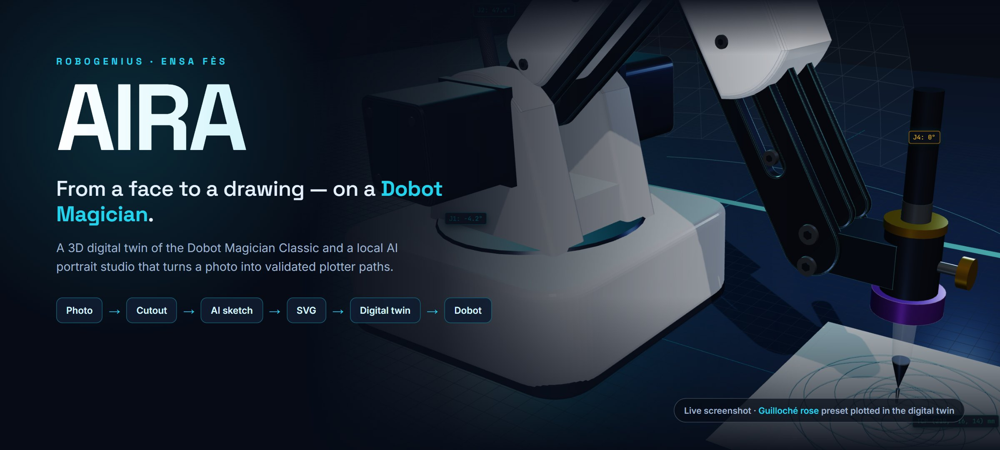
</p>

<p align="center">
  <a href="#run-the-main-studio-on-windows"></a>
  <a href="#safety-by-design"></a>
</p>
<p align="center">
  
  
  
  
  
  
  
</p>
<p align="center">
  <a href="#aira-in-one-minute">Overview</a> ·
  <a href="#see-it-draw">See it draw</a> ·
  <a href="#what-works-today">Features</a> ·
  <a href="#from-photo-to-pen-strokes">AI pipeline</a> ·
  <a href="#architecture">Architecture</a> ·
  <a href="#safety-by-design">Safety</a> ·
  <a href="#run-the-main-studio-on-windows">Setup</a>
</p>

---

## AIRA in one minute

A visitor sits in front of the camera. Moments later, a **Dobot Magician Classic** starts drawing their portrait with a pen.

AIRA is the software behind that experience at the **RoboGenius Robotics Lab (ENSA Fès)**. It pairs a **3D digital twin** of the robot with a **local AI portrait studio**: the photo is cut out, turned into an AI line sketch, traced into plotter-ready SVG strokes, previewed on the virtual robot, and only then sent to the real one, after the operator has validated the drawing and completed four physical setup checks.

| Step | What happens | Where it runs |
| --- | --- | --- |
| **1 · Photo** | Upload a portrait or capture one from the camera | Browser |
| **2 · Cutout** | MediaPipe removes the background | Browser |
| **3 · AI sketch** | AI Coloring (FLUX.2 [klein], free Cloudflare tier) draws a coloring-book page; Clean Line, U²-Net or ArtLine run fully offline | Cloudflare Workers AI or local Python service |
| **4 · SVG** | The approved sketch is traced into pen strokes, then validated against the paper | Browser |
| **5 · Digital twin** | The 3D Dobot plots the strokes so you can check reach, paper and pen | Browser (Three.js) |
| **6 · Dobot** | The validated job is streamed to the robot over USB serial | Local Python service |

> **Project status: experimental.** Start with the digital twin and a disconnected robot. Check the paper size, pen height, workspace clearance and the SVG before any physical job.

## See it draw

<p align="center">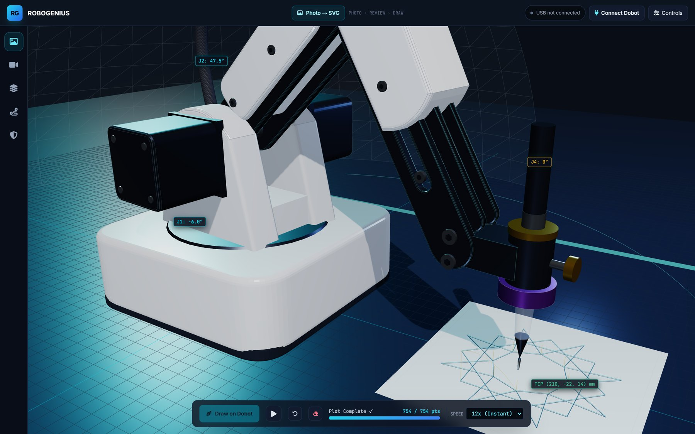</p>
<p align="center"><em>The built-in <b>ENSA Fès Moroccan zellige</b> preset, fully plotted by the digital twin: 754 points, joint angles and pen position updating live.</em></p>

<table>
  <tr>
    <td width="50%"><p align="center"><b>Guilloché spirograph rose</b><br><sub>1,531 points of continuous curve.</sub></p></td>
    <td width="50%">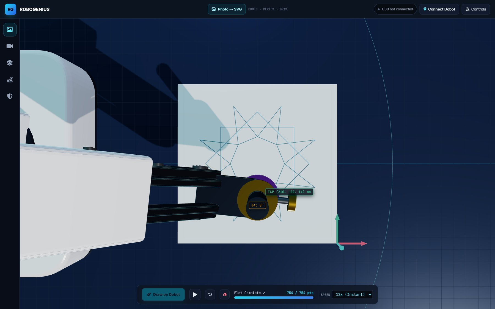<p align="center"><b>Top paper view</b><br><sub>Check placement inside the 130 × 130 mm sheet.</sub></p></td>
  </tr>
  <tr>
    <td>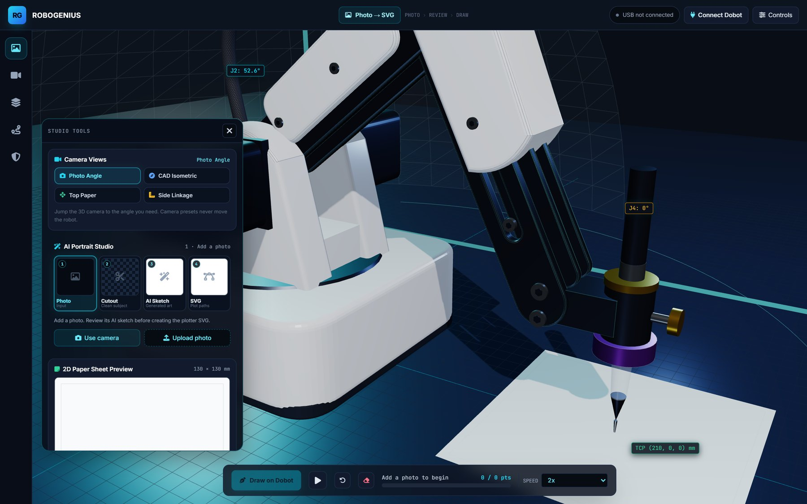<p align="center"><b>Studio tools</b><br><sub>Camera presets, the four-step portrait flow and the paper preview.</sub></p></td>
    <td>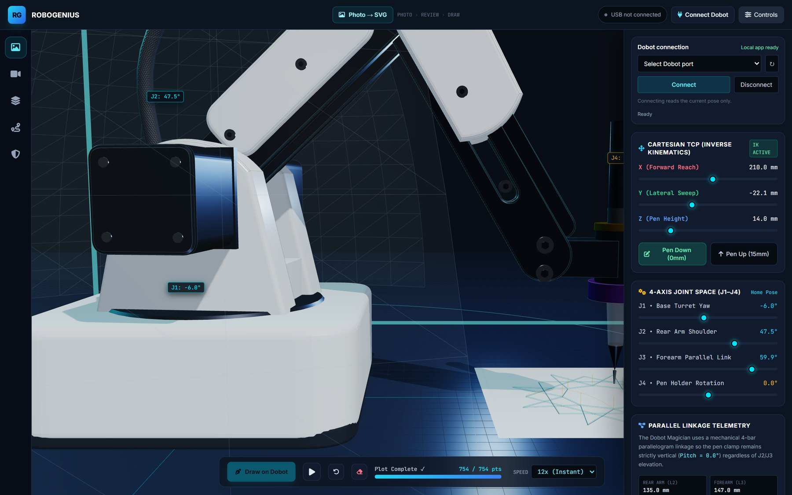<p align="center"><b>Robot controls</b><br><sub>Serial connection, Cartesian IK and J1–J3 joint space.</sub></p></td>
  </tr>
  <tr>
    <td>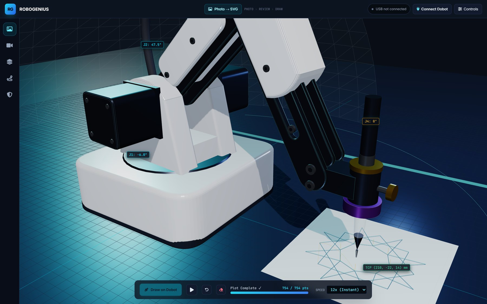<p align="center"><b>CAD isometric view</b></p></td>
    <td>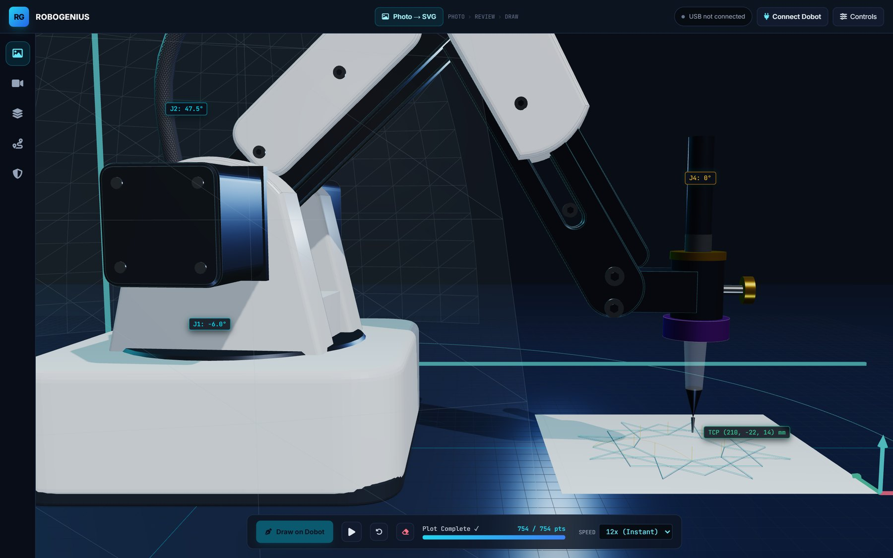<p align="center"><b>Side linkage view</b><br><sub>Inspect the parallelogram arm that keeps the pen vertical.</sub></p></td>
  </tr>
</table>

<sub>These screenshots are taken from the running app on a PC with no robot connected (<code>USB not connected</code>), using AIRA's built-in vector presets.</sub>

## From photo to coloring page

**AI Coloring** turns a portrait into a clean coloring-book page with FLUX.2 [klein] on the free Cloudflare Workers AI tier, then traces it into pen strokes on your computer. Photos without a person (a place, an object) keep their own composition instead of being turned into a portrait.

<p align="center">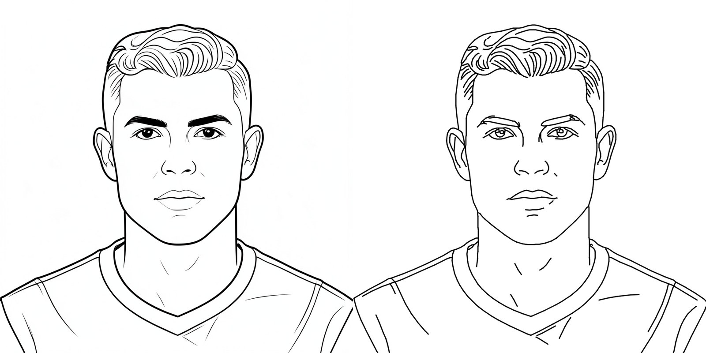</p>
<p align="center"><em>Left: the AI coloring page. Right: the centerline strokes the Dobot draws (traced locally in under a second).</em></p>

<table>
  <tr>
    <td width="50%">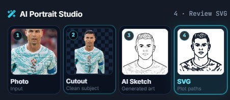<p align="center"><b>AI Coloring</b><br><sub>Clean outlines, hair strands, collar and seams.</sub></p></td>
    <td width="50%">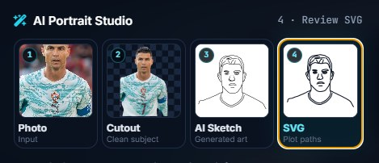<p align="center"><b>Clean Line (offline)</b><br><sub>The fallback when there is no key, no internet or no quota left.</sub></p></td>
  </tr>
  <tr>
    <td>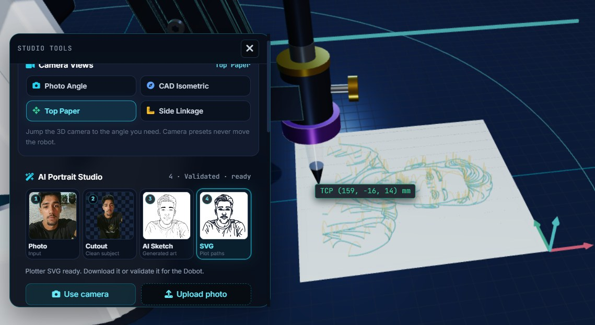<p align="center"><b>Validated and plotting</b><br><sub>A selfie drawn by the digital twin.</sub></p></td>
    <td>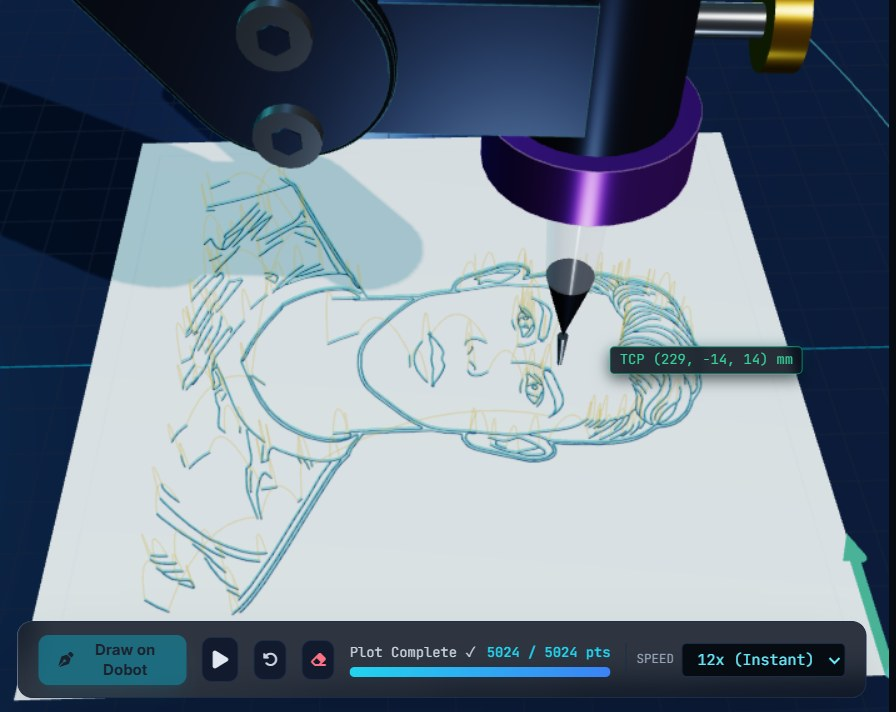<p align="center"><b>Plot complete</b><br><sub>5,024 points on the 130 × 130 mm sheet.</sub></p></td>
  </tr>
  <tr>
    <td colspan="2" align="center">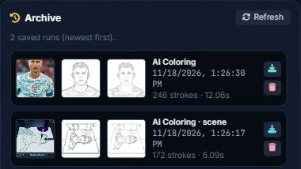<p align="center"><b>Archive</b><br><sub>Every AI Coloring and Clean Line run keeps its photo, sketch, SVG, date and processing time (stored in <code>archive/</code>, git-ignored). Download or delete runs from the studio.</sub></p></td>
  </tr>
</table>

## Create: draw anything, write text, use your voice

The **Create** panel (magic-wand icon) draws more than faces:

- **Describe**: type or say *"a small house with a tree and a sun"* or *"a cat next to a flower pot"*. AI Coloring makes a coloring page from the words and it is traced into pen strokes.
- **Write text**: single-line plotter fonts (Script, Handwriting, Simple, Serif, Gothic…). The pen draws each letter once, like handwriting, instead of tracing letter outlines.
- **Voice**: the microphone button uses **Whisper base**, running offline on the computer (Arabic, French, English and ~100 other languages). In Describe mode the speech is translated to English for the AI.

<table>
  <tr>
    <td width="42%">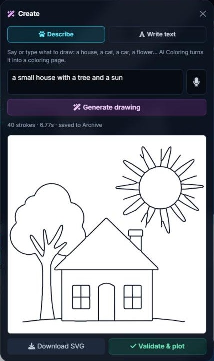<p align="center"><b>Describe</b><br><sub>Words → coloring page → 40 pen strokes in 7 s.</sub></p></td>
    <td width="58%">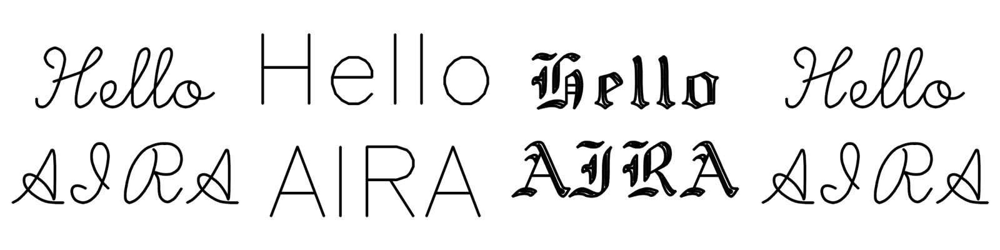<p align="center"><b>Write text</b><br><sub>Single-line fonts the pen draws in one pass per stroke.</sub></p>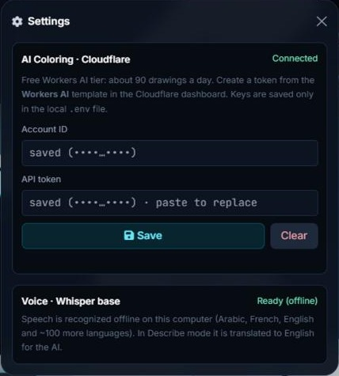<p align="center"><b>Settings</b><br><sub>Paste the Cloudflare key in the app; it is stored only in the local <code>.env</code>.</sub></p></td>
  </tr>
</table>

### How AIRA knows what it is looking at

- **Photo**: AIRA looks for a face. With a face it draws a head-and-shoulders portrait; with no face (a place, a house, an animal, an object) it asks the AI for a coloring page of *the same scene*, so nothing is turned into a person.
- **Describe**: you say what to draw, so there is nothing to guess.
- **Write text**: no AI at all; the letters come straight from the font.

## What works today

| Capability | Implemented behavior | Current boundary |
| --- | --- | --- |
| **Photo input** | Upload an image or capture from a webcam | Camera needs browser permission on the local address |
| **Background removal** | MediaPipe portrait segmentation in the browser | Works best on a centered, well-lit portrait |
| **AI sketch** | U²-Net Portrait Sketch (LiteRT) locally; optional ArtLine model; compare both | Results depend on the photo; models are downloaded during setup |
| **Sketch → SVG** | Trace the approved sketch, tune edge sensitivity/detail, preview and download | The sketch and the SVG are separate review steps, on purpose |
| **SVG validation** | Checks that every path fits inside the paper before it can be drawn | Validation is required for any physical job |
| **Digital twin** | GLB model of the Dobot, four camera presets, Cartesian IK, J1–J3 joints, live plot at 1×–12× | A simulation; verify the real setup before drawing |
| **Vector presets** | Studio portrait study, guilloché spirograph rose, Moroccan zellige, calibration grid | Ready-made test drawings, no photo needed |
| **Physical drawing** | Dobot Magician Classic over USB serial, job progress and stop | Connecting only reads the pose; drawing needs validation, confirmation and four checks |
| **Model export** | Export the digital-twin robot as GLB | — |
| **Standalone studio** | `svg gen/`: face-aware crop, ONNX line art, stroke filtering, SVG cleanup | Separate app on its own port and environment |

## From photo to pen strokes

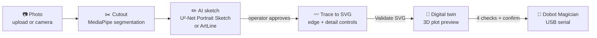

Two human checkpoints are built into the flow: the operator **approves the AI sketch** before it becomes vectors, and **validates the SVG** before it can reach the robot.

### The models

| Task | Model | How it runs |
| --- | --- | --- |
| Portrait line sketch (default) | [U²-Net Portrait Sketch](https://huggingface.co/litert-community/U2Net-Portrait-Sketch-LiteRT) (~176 MB) | LiteRT in the project's `.venv`, via [`portrait_sketch_runner.py`](portrait_sketch_runner.py) |
| Portrait line sketch (optional) | [ArtLine](https://github.com/vijishmadhavan/ArtLine) (~356 MB checkpoint) | Separate Python 3.8 environment, via [`artline_runner.py`](artline_runner.py) |
| Background removal | MediaPipe segmentation | In the browser |
| Standalone line art | [Informative Drawings ONNX](https://huggingface.co/rocca/informative-drawings-line-art-onnx) + `rembg` + [YuNet](https://github.com/opencv/opencv_zoo/tree/main/models/face_detection_yunet) | `svg gen/` server, CPU inference |

## Architecture

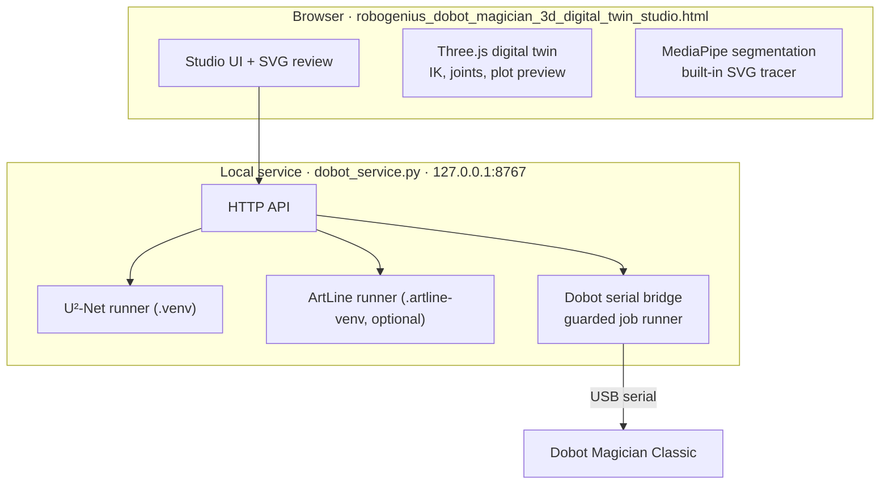

| Endpoint | Purpose |
| --- | --- |
| `GET /api/status`, `/api/artline/status`, `/api/portrait-sketch/status` | Service, model and robot status |
| `POST /api/portrait-sketch`, `/api/artline` | Run a local sketch model on the cutout |
| `POST /api/connect`, `/api/disconnect` | Open or close the serial link (connecting reads the pose only) |
| `POST /api/draw` | Start a validated, confirmed job |
| `POST /api/stop` | Stop the running job |

The serial bridge speaks the Dobot binary protocol (`0xAA 0xAA`, length, payload, checksum) and rejects any frame whose checksum fails.

## Safety by design

A robot arm holding a pen is still a robot arm. The local service **refuses a drawing job** unless every condition below is true:

| Guard | Enforced in |
| --- | --- |
| The SVG has been **validated** in the app | `dobot_service.py` → job rejected otherwise |
| The operator has **explicitly confirmed** the job | `dobot_service.py` |
| All four physical checks are done: **workspace**, **pen**, **clearance**, **operator present** | `dobot_service.py` |
| Every path stays inside the **validated paper area** | `dobot_service.py` |
| There is at least one path to draw | `dobot_service.py` |

Also by design: both services listen on **loopback only** (this computer), connecting to the robot **does not start motion**, request bodies are size-limited, and photos are processed locally. Keep the work area clear, stay by the robot during motion, and use the physical stop if anything looks wrong.

## Run the main studio on Windows

### Requirements

- Windows 10 or 11
- Python 3.13 and the Python Launcher (`py`)
- Internet access for Python packages, browser libraries and model downloads
- A Dobot Magician Classic and its USB/serial driver, **only** for physical drawing

No robot is needed to explore the digital twin, plot the presets, upload a photo or prepare an SVG.

### Install and start

```powershell
powershell -ExecutionPolicy Bypass -File .\Setup-Clean-Line.ps1
powershell -ExecutionPolicy Bypass -File .\Setup-Portrait-Sketch.ps1
.\Run-RoboGenius.ps1
```

`Setup-Clean-Line.ps1` installs the **Clean Line** engine (the default sketch style) and downloads its four models (~250 MB) into `models/`: BiSeNet face parsing, the U²-Net human matte, the Informative Drawings line network and the YuNet face detector. The portrait-sketch script creates `.venv`, installs the dependencies and downloads the ~176 MB U²-Net model into `models/`. The run script starts the local service; open the address it prints, normally **http://127.0.0.1:8767/**.

The page loads Three.js, Tailwind and MediaPipe from CDNs, so the browser needs internet access the first time.

**AI Coloring (default, free tier).** For coloring-book pages like a professional illustration, the studio sends the cropped head-and-shoulders portrait to FLUX.2 [klein] on Cloudflare Workers AI and traces the returned page into plotter strokes locally. The free Workers AI allocation (10,000 neurons/day, reset 00:00 UTC) covers about 90 drawings a day. To enable it, copy `.env.example` to `.env` and fill in your Cloudflare account ID and an API token made from the **Workers AI** template, then restart the service. Without a key, offline, or once the daily quota is used, AI Coloring falls back to local Clean Line automatically. With AI Coloring the photo leaves the machine; every other style keeps photo processing on the machine.

**Optional: ArtLine.** It uses a separate Python 3.8 environment and a ~356 MB checkpoint:

```powershell
powershell -ExecutionPolicy Bypass -File .\Setup-ArtLine.ps1
```

Restart the main studio afterwards. Without ArtLine, U²-Net and the browser's built-in tracer remain available.

### Desktop app (no browser)

AIRA can run as a normal Windows app in its own window (Microsoft Edge WebView2, built into Windows 10/11):

```powershell
.venv\Scripts\python.exe aira_desktop.py          # run it from the source folder
powershell -ExecutionPolicy Bypass -File .\Build-Desktop.ps1   # build dist\AIRA\AIRA.exe
```

`Build-Desktop.ps1` packages the studio, the Python service and the models into `dist\AIRA\` (zip that folder to share it). Open **Settings** (gear icon) to paste the Cloudflare key; it is saved next to the app in `.env`. The app still needs internet for the 3D libraries and for AI Coloring; Clean Line, Write text and voice work offline. ArtLine and U²-Net Portrait Sketch are not included in the desktop build.

### Draw a portrait

1. Open **AI Portrait Studio** and upload or capture a photo.
2. Review the cleaned cutout.
3. Wait for the **AI Sketch**, then inspect it. **AI Coloring** (default) gives the cleanest coloring-book page; **Clean Line** builds one fully offline; switch to U²-Net or ArtLine to compare sketch styles. With Clean Line, *Detail* and *Edge sensitivity* control facial detail and hair/clothing lines, and tracing again re-runs it with the new settings.
4. Click **Trace sketch to SVG** only when the sketch looks right. Adjust edge sensitivity/detail and trace again if needed.
5. Review or download the paths, then **Validate SVG** when the paths and paper placement look right.
6. Watch the digital twin plot it. Connect the Dobot only when ready, complete the four setup checks and confirm the job.

> The pipeline depends on the photo. Use a well-lit, centered portrait and inspect the generated paths; no model guarantees a clean result for every image.

### Try it without a photo

Open **Presets** (layers icon) and pick a drawing: the digital twin starts plotting it immediately. Set **Speed** to `12x (Instant)` for a quick preview.

## Run the standalone AI portrait-to-SVG studio

`svg gen/` is a separate app with its own dependencies and pipeline. Keep its environment separate:

```powershell
py -3.12 -m venv .svg-gen-venv
.\.svg-gen-venv\Scripts\python.exe -m pip install --upgrade pip
.\.svg-gen-venv\Scripts\python.exe -m pip install -r ".\svg gen\requirements.txt"
.\.svg-gen-venv\Scripts\python.exe ".\svg gen\server.py"
```

Open **http://127.0.0.1:8766/**. The first launch downloads the ONNX portrait and face-detection models. Use `--port 8770` to change the port. See [`svg gen/README.md`](svg%20gen/README.md) for its API and quality settings.

## Repository contents

| Path | Purpose |
| --- | --- |
| [`robogenius_dobot_magician_3d_digital_twin_studio.html`](robogenius_dobot_magician_3d_digital_twin_studio.html) | Main Three.js digital twin and drawing UI |
| [`dobot_service.py`](dobot_service.py) | Loopback-only web service and guarded Dobot serial bridge |
| [`portrait_lineart/`](portrait_lineart) | Clean Line engine: face-aligned framing, face parsing, coloring-book line composition and the centerline vectorizer (`vectorize.py`); `cloud_ai.py` is the AI Coloring client; `create.py` is Describe, Write text, voice and settings; `archive.py` stores past runs |
| [`aira_desktop.py`](aira_desktop.py), `Build-Desktop.ps1` | Desktop app window and its PyInstaller build |
| [`portrait_sketch_runner.py`](portrait_sketch_runner.py) | Local LiteRT inference for U²-Net Portrait Sketch |
| [`artline_runner.py`](artline_runner.py) | Optional ArtLine inference adapter |
| `Setup-Clean-Line.ps1`, `Setup-Portrait-Sketch.ps1`, `Setup-ArtLine.ps1`, `Run-RoboGenius.ps1` | Installers and launcher |
| `dobot_magician_classic_digital_twin.glb` | 3D robot model |
| [`svg gen/`](svg%20gen) | Standalone AI portrait-to-SVG studio |
| `RoboGenius_Dobot_AI_Portrait_Project_Dossier.pdf` | Project dossier |
| `docs/readme/` | README screenshots |

Model weights and Python environments are excluded from Git; the setup scripts download them.

## Troubleshooting

| Problem | Fix |
| --- | --- |
| Port 8767 is busy | `$env:ROBOGENIUS_PORT = '8771'` before starting, then open the printed address |
| "AI Coloring unavailable, used local Clean Line" | Check `.env` (account ID and token), internet access, or wait for the daily free quota to reset at 00:00 UTC |
| Clean Line unavailable or very sparse | Re-run `Setup-Clean-Line.ps1` (face parsing is what draws hairline, jaw, eyes and lips), restart the service |
| Portrait Sketch unavailable | Re-run `Setup-Portrait-Sketch.ps1`, confirm the model downloaded, restart the service |
| ArtLine unavailable | It's optional; install with `Setup-ArtLine.ps1` |
| Microphone doesn't work | Allow microphone access when asked; in Settings check that *Voice · Whisper base* says *Ready*, otherwise re-run `Setup-Clean-Line.ps1` |
| Write text shows nothing for Arabic | The single-line fonts cover Latin, Greek and Cyrillic; use Describe for Arabic words |
| Camera doesn't open | Use the local `http://127.0.0.1` address, allow camera access, close other apps using it |
| No Dobot port listed | Check the USB cable and serial driver, reconnect the robot, press refresh |
| Standalone studio slow on first run | It's downloading ONNX models and warming up CPU inference |

## Models and licensing

- [U²-Net Portrait Sketch LiteRT](https://huggingface.co/litert-community/U2Net-Portrait-Sketch-LiteRT): Apache-2.0 model card.
- [ArtLine](https://github.com/vijishmadhavan/ArtLine): MIT upstream; checkpoint downloaded separately.
- [Informative Drawings ONNX](https://huggingface.co/rocca/informative-drawings-line-art-onnx) and [YuNet](https://github.com/opencv/opencv_zoo/tree/main/models/face_detection_yunet): downloaded by the standalone app. Check upstream terms before redistribution or commercial use.
- [BiSeNet face parsing ONNX](https://github.com/yakhyo/face-parsing) (Clean Line): MIT code; the weights are trained on CelebAMask-HQ, whose terms are non-commercial research and education only.
- [U²-Net human segmentation](https://github.com/xuebinqin/U-2-Net) (person matte, Apache-2.0), the ONNX export published by [rembg](https://github.com/danielgatis/rembg): downloaded by `Setup-Clean-Line.ps1` and run directly on onnxruntime.
- [FLUX.2 [klein] 4B](https://developers.cloudflare.com/workers-ai/models/flux-2-klein-4b/) on Cloudflare Workers AI (AI Coloring, Describe): used through your own Cloudflare account under Cloudflare's and Black Forest Labs' terms.
- [Whisper base](https://huggingface.co/Systran/faster-whisper-base) via [faster-whisper](https://github.com/SYSTRAN/faster-whisper) (voice): MIT.
- [Hershey fonts](https://github.com/apshu/HersheyFonts) (Write text): MIT package; the Hershey font data is public domain.
- Python packages and browser libraries keep their own licenses.

No license has been chosen yet for AIRA's own source code, so publishing the repository does not grant reuse rights.

---

<p align="center">Built at the <strong>RoboGenius Robotics Lab · ENSA Fès</strong> by <strong>Marwane Haddane</strong> · <a href="https://github.com/Marwane-Haddane">GitHub</a></p>
